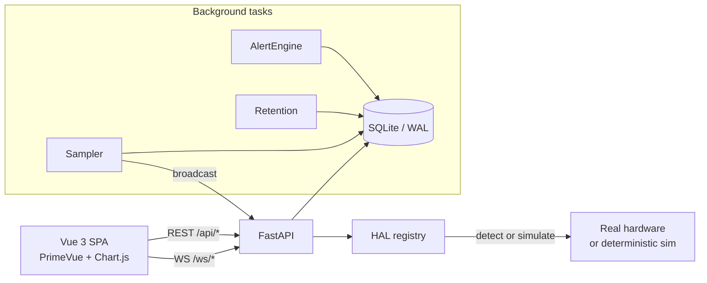

# Embedded Linux Device Dashboard

A complete, production-grade web dashboard for an ARM embedded Linux device:
device overview, networking, hardware I/O, storage, thermal, software/OTA,
file/log management, security & compliance, cloud connectivity, and settings —
served by a single Python process with a zero-build Vue 3 SPA.

It runs **out of the box on an x86 dev laptop** by simulating every hardware
interface, and runs the same code against real hardware on the device.

```bash
pip install -r requirements.txt
python -m app.main           # -> http://localhost:8000  (login: admin / admin)
```

---

## Architecture



- **Backend** — FastAPI single process. REST under `/api/*`, WebSockets under
  `/ws/*`, the SPA served from `/static` with a catch-all fallback so deep links
  work on refresh.
- **HAL (Hardware Abstraction Layer)** — every subsystem implements a
  `HalModule` that either talks to real hardware or returns *deterministic*
  simulated data. Each response is tagged `{"simulated": true|false}` so the UI
  can show a banner. See [app/hal/](app/hal).
- **Auth** — JWT (HS256), bcrypt password hashing, three roles
  (`viewer` < `operator` < `admin`), account lockout after repeated failures,
  and a forced password change for the seeded admin. See [app/auth/](app/auth).
- **Persistence** — one aiosqlite connection in WAL mode with idempotent,
  versioned migrations and an append-only audit log. See [app/db/](app/db).
- **Frontend** — Vue 3 global build + Vue Router (hash history) + PrimeVue +
  Chart.js, **all self-hosted** in `static/vendor` (no CDN, no build step).

### Project layout

| Path | Purpose |
| --- | --- |
| [app/main.py](app/main.py) | App factory, lifespan, router wiring, SPA mount |
| [app/config.py](app/config.py) | Single `config.yaml`, pydantic-validated |
| [app/auth/](app/auth) | JWT, roles, lockout, user service |
| [app/hal/](app/hal) | Hardware abstraction + deterministic simulation |
| [app/routers/](app/routers) | One router per feature group |
| [app/ws/](app/ws) | WebSocket channels (metrics, logs, terminal, OTA, CAN) |
| [app/tasks/](app/tasks) | Sampler, alert engine, OTA, backup, retention |
| [static/](static) | Zero-build Vue SPA (10 feature pages) |
| [deploy/](deploy) | systemd unit, installer, vendor fetcher |
| [tests/](tests) | pytest validation suite |

---

## Running

```bash
make install     # create .venv and install runtime + dev dependencies
make run          # start on http://localhost:8000
make dev          # autoreload for development
```

Configuration is a single optional `config.yaml` (see
[config.example.yaml](config.example.yaml)); every field has a default, so no
config is required to boot. Override the location with `DASHBOARD_CONFIG=/path`.

## Simulation mode

When a real interface is not present (e.g. on a laptop), the corresponding HAL
module automatically switches to **simulated** data that is deterministic
(seeded RNG) and time-varying (smooth waves) so charts animate and topology is
stable across reloads. Force it everywhere with:

```yaml
simulation:
  force: true
```

Every simulated payload carries `"simulated": true`, surfaced in the UI banner
and at `GET /api/system/simulation`.

## Device permissions

On a real device the service account needs access to the interfaces you use.
Grant the minimum your deployment requires:

| Feature | Needs | How |
| --- | --- | --- |
| GPIO | `/dev/gpiochip*`, `/sys/class/gpio` | `gpio` group |
| I²C | `/dev/i2c-*` | `i2c` group |
| SPI | `/dev/spidev*` | `spi` group |
| Serial / CAN | `/dev/tty*`, `/dev/can*` | `dialout` group |
| Thermal / sensors | `/sys/class/thermal`, `/sys/class/hwmon` | read access |
| Systemd services | `systemctl` | polkit rule |
| Reboot / shutdown | `systemd-logind` | polkit rule or `CAP_SYS_BOOT` |
| OTA (SWUpdate) | SWUpdate socket/API | reachable `swupdate.base_url` |

The shipped [deploy/dashboard.service](deploy/dashboard.service) runs as an
unprivileged `dashboard` user with systemd hardening and only the supplementary
groups listed above — remove any you don't need.

## Air-gapped / offline frontend

All frontend libraries are vendored under `static/vendor` and committed, so the
dashboard makes **no external network requests** at runtime. To refresh or
re-pin them:

```bash
make fetch-vendor      # downloads + rebuilds static/vendor/*
```

This runs [deploy/fetch-vendor.sh](deploy/fetch-vendor.sh), which pins exact
versions and rebuilds the PrimeVue UMD bundle via
[deploy/build_vendor_bundle.py](deploy/build_vendor_bundle.py).

---

## Validation

```bash
make validate     # ruff (lint+format) + mypy (strict) + pytest + 85% coverage gate
# or, without make:
./validate.sh
```

The suite ([tests/](tests)) covers config validation, path-traversal defense,
the alert engine (mock clock + DB integration), encrypted backup round-trips,
HAL simulation determinism, idempotent migrations, the full auth/lockout matrix
(the **role matrix is auto-derived** from the live route table, so a new
unguarded write endpoint fails CI automatically), every read endpoint, the major
write flows, and the WebSocket channels (metrics, logs, CAN, and a full
simulated OTA install).

## Deployment

```bash
sudo deploy/install.sh    # service user + venv + config + systemd unit
systemctl status dashboard
journalctl -u dashboard -f
```

---

## Extending: add a new panel

The codebase is intentionally uniform — adding a feature touches three layers:

1. **HAL** — add a method to the relevant module in [app/hal/](app/hal) (or a
   new `HalModule` subclass + register it in
   [app/hal/registry.py](app/hal/registry.py)). Return `self.envelope({...})`
   and provide a deterministic simulated branch.
2. **Router** — add an endpoint in the matching file under
   [app/routers/](app/routers), guarded by `require_viewer/operator/admin`, and
   `await audit.record(...)` for any state change.
3. **Page** — add UI in the corresponding file under
   [static/js/pages/](static/js/pages) (register the route in the SPA shell).
4. **Test** — the route-driven smoke test picks up new read endpoints
   automatically; add a targeted test for new write flows.

Run `make validate` and you're done.
